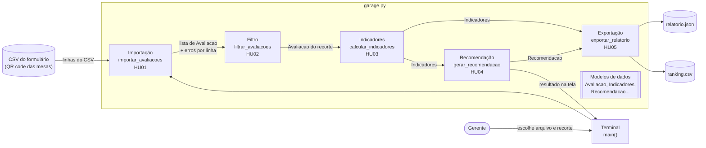

# Sprint 3 - Arquitetura e desenvolvimento

Nesta sprint a gente implementou as cinco histórias da Sprint 2 no `garage.py`. Os 20 testes do `testesGarage.py` passam sem nenhuma alteração nos testes, e o sistema pode ser usado pelo terminal.

## 1. Diagrama da arquitetura



O diagrama aparece desenhado quando o arquivo é aberto no GitHub.

## 2. Componentes e responsabilidades

| Componente | Função | Responsabilidade | Recebe | Devolve |
| --- | --- | --- | --- | --- |
| Terminal | `main()` | Lê os argumentos (arquivo, recorte, mínimo, saída), chama os componentes na ordem e mostra o resultado. | Comando digitado pelo gerente | Texto na tela |
| Importação | `importar_avaliacoes` | Lê o CSV, confere o cabeçalho, valida cada linha e converte os tipos. Linha com problema vira um erro com número e motivo, sem parar a leitura. | Caminho do CSV | `ResultadoImportacao` (avaliações válidas + erros) |
| Filtro | `filtrar_avaliacoes` | Separa só as respostas do recorte escolhido (período, dia da semana, horário e TV). Recusa parâmetros inválidos. | Lista de `Avaliacao` + filtros | Lista de `Avaliacao` |
| Indicadores | `calcular_indicadores` | Agrupa por conteúdo e calcula quantidade, média e aceitação. Conta as preferências separado. | Lista de `Avaliacao` | `Indicadores` |
| Recomendação | `gerar_recomendacao` | Aplica o mínimo de avaliações e ordena o ranking (aceitação, preferências, nome). | `Indicadores` + mínimo | `Recomendacao` |
| Exportação | `exportar_relatorio` | Grava o resultado completo em JSON e o ranking em CSV, sem sobrescrever arquivos que já existem. | `Indicadores` + `Recomendacao` + caminhos | Arquivos `.json` e `.csv` |
| Modelos de dados | `Avaliacao`, `ErroImportacao`, `ResultadoImportacao`, `ResumoConteudo`, `Indicadores`, `Recomendacao` | Guardam os dados que passam de um componente para o outro. | | |

## 3. Comunicação entre os componentes

Os componentes não leem nem escrevem nada um do outro: cada um recebe o resultado do anterior como parâmetro e devolve um objeto novo. O fluxo é sempre o mesmo:

1. O gerente roda o programa no terminal, informando o CSV e, se quiser, o recorte.
2. A **Importação** devolve as avaliações válidas e a lista de erros. Os erros só são mostrados, não interrompem o resto.
3. O **Filtro** recebe as avaliações válidas e devolve só as do recorte.
4. Os **Indicadores** são calculados em cima do recorte.
5. A **Recomendação** usa os indicadores para montar o ranking.
6. Se o gerente pedir, a **Exportação** recebe os indicadores e a recomendação e grava os dois arquivos.

Como cada parte só depende da entrada que recebe, dá para testar cada uma separada, que é o que os testes fazem.

## 4. Decisões tomadas na implementação

- **Data:** só aceita o formato `AAAA-MM-DDTHH:MM:SS`, como está no contrato do CSV. Outro formato (por exemplo `31/10/2026 20:10`) recusa a linha.
- **ID repetido:** a linha primeiro é validada e só depois o ID é conferido. Assim, uma linha com erro não "reserva" o ID, como pede o HU01-CA04.
- **Parâmetros do filtro:** são conferidos antes de olhar a lista, então um filtro errado dá erro mesmo com a lista vazia (HU02-CA04).
- **Inteiros:** `True` e `False` contam como inteiros em Python, por isso o código recusa booleanos explicitamente no mínimo de avaliações e no dia da semana (HU04-CA04).
- **Exportação:** confere os dois destinos antes de escrever qualquer arquivo, para nunca ficar só um dos dois gravado (HU05-CA03).

## 5. Como executar

Precisa de **Python 3.10 ou mais novo**. Só usa a biblioteca padrão.

**Testes** (na raiz do repositório):

```bash
python -m unittest -v testesGarage
```

Resultado esperado: `Ran 20 tests ... OK`.

**Demonstração das histórias pelo terminal:**

```bash
# Todas as respostas do exemplo, salvando o relatório em JSON e CSV (HU01 a HU05)
python garage.py dados/exemplo_avaliacoes_simuladas.csv --saida relatorio

# Só sexta-feira (dia 4), das 19h às 20h, na TV1 (HU02): sem o mínimo de 5 avaliações
python garage.py dados/exemplo_avaliacoes_simuladas.csv --dia 4 --hora-inicio 19 --hora-fim 20 --tv TV1

# O mesmo recorte com mínimo de 2 avaliações (HU04)
python garage.py dados/exemplo_avaliacoes_simuladas.csv --dia 4 --hora-inicio 19 --hora-fim 20 --minimo 2

# Arquivo com linhas inválidas: mostra o número da linha e o motivo (HU01)
python garage.py dados/exemplo_com_erros.csv
```

Para ver todas as opções: `python garage.py --help`.

Se rodar o primeiro comando duas vezes, a segunda dá erro de propósito, porque `relatorio.json` já existe (HU05-CA03). Apague os dois arquivos ou use outro nome em `--saida`.

**Resultado do primeiro comando** (dados inventados, o mesmo da seção 8 do `Sprint_2.md`):

```
Conteúdo     Avaliações   Média  Aceitação  Preferências
pop                   5    4.20      80.0%             8
rock                  5    3.60      60.0%             3
futebol               5    3.00      40.0%             4

Recomendação (mínimo de 5 avaliações): POP
Ranking: 1. pop  2. rock  3. futebol
```

## 6. Arquivos da sprint

| Arquivo | Conteúdo |
| --- | --- |
| `garage.py` | As cinco funções implementadas e a execução pelo terminal |
| `testesGarage.py` | Os 20 testes da Sprint 2, sem alteração |
| `dados/exemplo_avaliacoes_simuladas.csv` | 15 respostas inventadas para a demonstração |
| `dados/exemplo_com_erros.csv` | Respostas com erros de propósito, para mostrar a validação |
| `Documentos/Sprint_3.md` | Este documento, com o diagrama da arquitetura |
